# Project Kefrec - ERD PlantUML

File PlantUML utama ada di `docs/erd.puml`.

Kalau file `.puml` tidak bisa dibuka langsung, buka file ini atau `docs/erd.txt` sebagai teks biasa.
Untuk melihat diagram visual, buka `docs/erd.puml` dengan salah satu cara berikut:

- VS Code: install extension `PlantUML`, lalu buka `docs/erd.puml` dan pilih preview.
- Online renderer: buka https://www.plantuml.com/plantuml, lalu tempel isi `docs/erd.puml`.
- Lokal: install Java dan PlantUML, lalu jalankan `plantuml docs/erd.puml`.

```plantuml
@startuml
title Project Kefrec - Entity Relationship Diagram

hide circle
skinparam linetype ortho
skinparam shadowing false
skinparam roundcorner 8
skinparam packageStyle rectangle
skinparam class {
  BackgroundColor #FFFFFF
  BorderColor #333333
  ArrowColor #333333
}

' Source of truth:
' - database/migrations
' - app/Models Eloquent relationships
'
' Open docs/erd.puml for the complete diagram source.
@enduml
```

Catatan analisis:

- `products.category_id` hanya indexed di migration, belum punya constraint foreign key, tapi tetap dipakai secara konseptual oleh model `Category`.
- `audit_logs.subject_type` + `subject_id` adalah polymorphic reference.
- `personal_access_tokens.tokenable_type` + `tokenable_id` adalah polymorphic reference.
- `cashflows.source` dan `cashflows.notes` menghubungkan event bisnis secara konvensi, bukan FK database.
